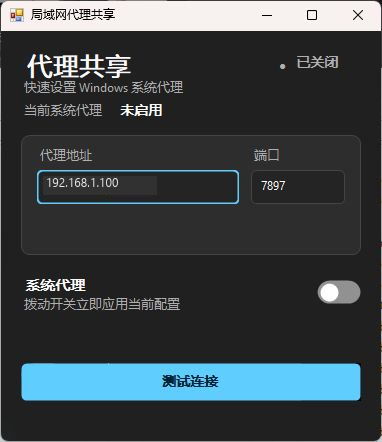

# 🌐 Proxy Share

轻量的 Windows 系统代理开关，使用原生 WinForms 构建，无第三方运行时依赖。

## 🖼️ 界面预览



## ✨ 特性

- 🎨 Windows 11 风格，自动跟随系统深浅色主题
- ⚡ 一键启停当前用户的系统代理
- 🖥️ 下拉切换代理主机，支持添加、删除和编辑，自动保存选择
- ⏱️ 一键测试所有主机的 TCP 延迟，结果显示在下拉菜单
- 🔎 开关反映系统代理与所选主机是否一致，启动提示其他代理软件
- 🛡️ 自动校验 IP 地址与端口
- 🧪 后台测试代理连接，界面保持流畅
- 📦 单文件 EXE，体积仅几十 KB

## 🛠️ 构建

需要 Windows 与 .NET Framework 4.0：

```bat
compile.bat
```

构建结果为 `ProxyShare.exe`。

当前版本记录在 [`VERSION`](VERSION) 中，构建产物的文件版本与程序集版本会自动采用该值。

## 📦 发布

发布新版本时，先更新 `VERSION`（格式为 `X.Y.Z`）并提交，然后创建并推送同版本 tag：

```bash
git tag v1.0.0
git push origin v1.0.0
```

GitHub Actions 会自动运行测试、编译 Windows EXE，并创建 GitHub Release。Release 包含单独的 `ProxyShare.exe`、ZIP 压缩包及 SHA-256 校验文件。tag 版本必须与 `VERSION` 完全一致。

## 🚀 使用

从下拉菜单选择主机，旁边的“编辑”按钮可添加、删除或编辑名称、代理地址和端口。内置“一帆”（`192.168.1.72:7897`）和“赵博”（`192.168.1.4:7892`），默认选择赵博；升级时保留此前保存的端点。

切换主机立即更新系统代理地址和端口，并保持系统原有的启用状态。拨动“系统代理”开关可启用所选主机；关闭时沿用接管前配置恢复机制。无论是否启用，界面始终预览所选主机。只有系统手动代理开启且端点一致时，开关才显示开启。

点击“测试所有延迟”后展开下拉菜单，可查看所有主机到代理端口的 TCP 连接耗时（毫秒）或“不可达”；该结果表示端口连通性。点击“测试连接”可进一步检查经该代理访问网络的能力。

启动检测到 Clash Verge、Clash Party、FlClash 或 mihomo 相关进程时显示提示，程序功能仍可正常使用。

> ⚠️ 程序会修改当前 Windows 用户的系统代理设置，请确认地址与端口正确。

## 🗺️ 维护

修改代码前请先阅读 [ARCHITECTURE.md](ARCHITECTURE.md)，完成后同步更新项目地图。
